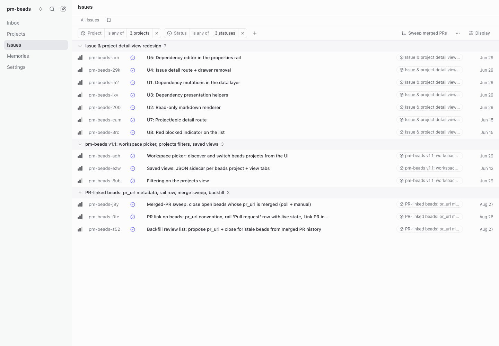

# pm-beads

A local, Linear-style web UI for the [Beads](https://github.com/steveyegge/beads) (`bd`) issue tracker. Give humans and coding agents a shared view of work: issues, projects, decisions, and progress in the same Beads database.



## What you can do

- Organize issues in a list or board; browse projects as a list, board, or containment hierarchy.
- Create and edit issues with descriptions, priorities, assignees, labels, dependencies, and PR links.
- Answer agent questions in an Inbox built from structured asks on work beads.
- Save filtered views and switch between local Beads workspaces.
- Opt into remote Dolt sync, review conflicts, and receive browser alerts for sync problems.
- Link GitHub PRs and preview a sweep of completed work.
- Let agents validate fresh ask metadata and conflicts through a read-only check API.

This is an early source release. It runs on your machine and is not distributed as an npm application. `package.json` stays `"private": true`.

## Quick start

Tested with **Node 24, Bun 1.3.14, bd 1.2.2, and Dolt 2.5.0**. Install [Beads](https://github.com/steveyegge/beads) and [Dolt](https://docs.dolthub.com/introduction/installation) and ensure both are on `PATH`. Optional PR features also need authenticated [GitHub CLI](https://cli.github.com/).

```bash
git clone https://github.com/Setpiece-Studio/pm-beads.git
cd pm-beads
bun install --frozen-lockfile
PM_BEADS_PROJECT_DIR=/absolute/path/to/your/project PM_BEADS_USER=your-handle bun run dev
```

Open **http://localhost:8345**. Replace the path with an existing Dolt-backed Beads repository and `your-handle` with the identity you want on comments and answers. The public checkout contains no Beads database; initialize a separate project with `bd init` if you do not have one.

With [mise](https://mise.jdx.dev/), run `mise trust` after reviewing `mise.toml`, then `mise install` to install the pinned Node and Bun versions. Use `mise exec -- bun install --frozen-lockfile` and `PM_BEADS_PROJECT_DIR=/absolute/path/to/your/project PM_BEADS_USER=your-handle mise exec -- bun run dev` if mise is not activated in your shell.

| Setting | Purpose |
| --- | --- |
| `PM_BEADS_PROJECT_DIR` | Default workspace. Without it, the app uses its working directory. |
| `PM_BEADS_USER` | Your write identity; optional comma-separated aliases. Set it explicitly—the legacy fallback is `ben`. |
| `PM_BEADS_SCAN_DIRS` | Colon-separated directories for workspace discovery, two levels deep. Defaults to `~/Developer:~/developer`. |

## Agent skill

Install the companion skill **in the project your agent works on**:

```bash
npx skills add Setpiece-Studio/pm-beads --skill pm-beads
```

The [skills installer](https://github.com/vercel-labs/skills) prompts for your coding agents. Add `-g` if you prefer a global installation. It installs instructions, not the application or `bd`. From a local source checkout you can also use `npx skills add /absolute/path/to/pm-beads --skill pm-beads`.

The skill focuses on writing work for the human reading pm-beads: current descriptions, well-scoped epics, substantive discussion, and structured review asks. It includes example epics and issues, plus local validation and sync checks. Use the basic Beads skill and `bd prime` for CLI usage. Read [the skill](skills/pm-beads/SKILL.md) before installing it.

## Learn the workflow

See the [usage guide](docs/USAGE.md) for view controls, creating work, answering asks, sync conflicts, and browser notifications. Screenshots show the pm-beads project itself; no database is bundled with the source.

Agents can check a workspace immediately after CLI writes:

```bash
curl --fail-with-body --get 'http://localhost:8345/api/check' \
  --data-urlencode 'project=/absolute/path/to/your/project'
```

HTTP 200 means the check completed, not necessarily that it passed: inspect `ok` and `issues`. See [check response semantics](CONTRIBUTING.md#agent-checks-and-remote-sync).

## Security

**Run locally against repositories you trust. There is no authentication.** Anyone who can reach the server can operate the selected Beads workspace. Do not expose it to the public internet. Project configuration may execute environment commands, and sync uses your local credentials. See [SECURITY.md](SECURITY.md).

## Development and contributions

The app uses TanStack Start and React. Server functions call the local `bd` CLI; there is no hosted backend. Implementation conventions and isolated test setup live in [CONTRIBUTING.md](CONTRIBUTING.md), and terminology in [CONCEPTS.md](CONCEPTS.md).

```bash
bun run typecheck
bun run test
bun run lint
bun run build
bun run test:e2e
```

CI runs these checks on pushes and pull requests. Share bugs and feature requests through [GitHub Issues](https://github.com/Setpiece-Studio/pm-beads/issues). For release preparation, see the [release checklist](docs/OPEN_SOURCE_RELEASE.md).

## License

MIT. See [LICENSE](LICENSE) and [third-party notices](THIRD_PARTY_NOTICES.md).
