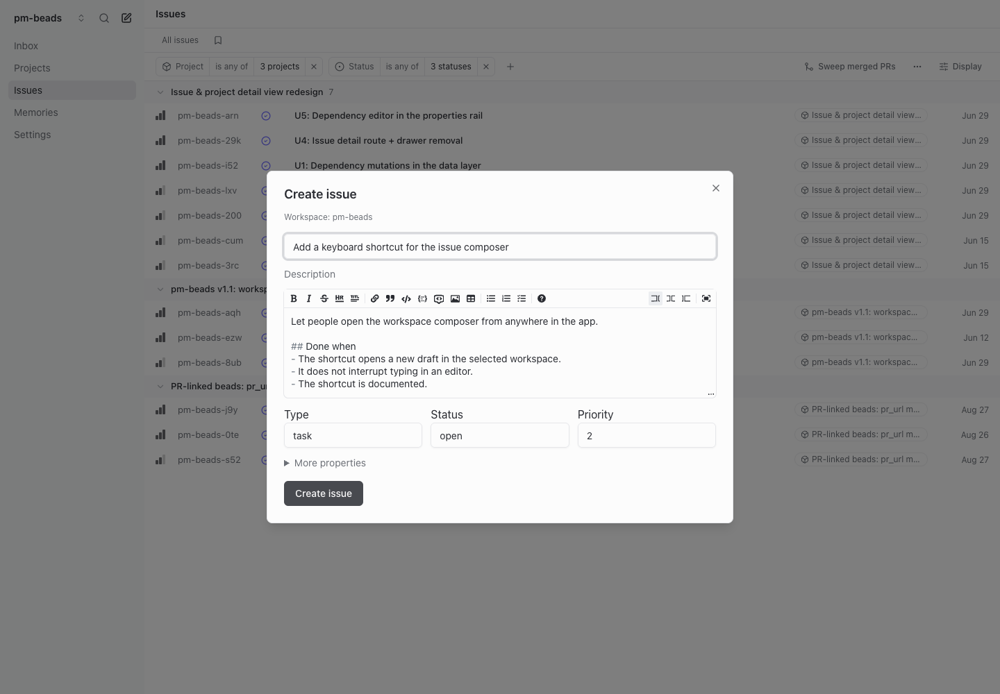
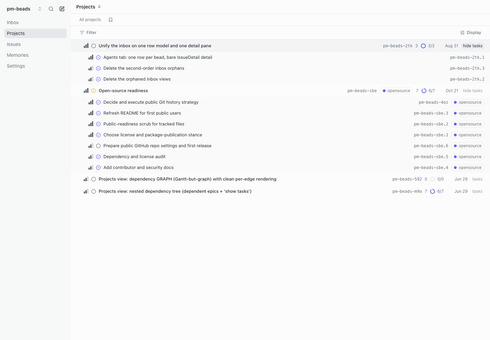

# Using pm-beads

If you use Linear, pm-beads should feel familiar: lists, boards, filters, project progress, and editable issue details. The main difference is the data underneath. pm-beads is a human-facing view of [Beads](https://github.com/steveyegge/beads), and its structure follows the Beads graph.

Start with the [installation instructions](../README.md#quick-start). Agents generally work through `bd`; you use pm-beads to read, discuss, and shape the same work. There is no separate copy of the tracker to keep aligned.

## Everything is a bead

A bead is a work record with a type, status, priority, description, assignee, and relationships to other beads. A task, bug, feature, or epic is a kind of bead—not a separate database object.

pm-beads calls **epic beads Projects**. They represent outcomes made up of child work. Other work beads appear under **Issues**. Changing a bead's type to or from `epic` moves it between those views without changing its identity.

A **workspace** is the Beads repository selected in the top-left picker. One workspace can contain many projects and issues. Switching workspaces selects another repository's database, not another epic.


## Relationships describe different things

Beads is a graph, so two connected items are not necessarily a parent and child. pm-beads keeps those relationships distinct:

| Relationship | Meaning | How it appears |
| --- | --- | --- |
| Parent–child | This work belongs within a larger piece of work. | Parent, sub-issues, and the containment hierarchy. |
| Blocks | One piece of work cannot proceed until another finishes. | Blocked by / Blocking. This affects readiness, not which project owns the work. |
| Related | Two beads provide context for each other. | Related links, without implying ownership or a prerequisite. |
| Discovered from | This work was found while investigating another bead. | A provenance link, not automatic containment. |

An issue can belong to one epic and be blocked by an issue in another. A blocking link should express a real prerequisite; priority expresses importance. Neither a label nor a bead's ID determines its parent. Existing dotted IDs are supported, but the relationship is what determines where a bead appears.

## Projects group work; status records its state

An epic has its own status, just like an issue. Its progress shows closed versus total children; that rollup and the epic's status are separate. Finishing every child makes completion worth reviewing—it does not mean the epic's status has already changed. A project can also exist before it has any children.

The available statuses come from the workspace's Beads configuration and data. pm-beads can configure their display order and icons, so a board follows that workspace's workflow rather than imposing one universal pipeline. Dragging a card between status columns writes the new status back to Beads.

Projects offers List, Board, and Hierarchy. Issues offers a list and board. Filters, grouping, ordering, and display options live in the view controls; saved views belong to the workspace. Closed projects are hidden until included by a status filter. Closed issues appear in the Done group when grouped by status; other groupings need an explicit status filter to include them.

### Custom statuses

Beads lets a workspace add statuses alongside `open`, `in_progress`, `blocked`, `deferred`, and `closed`. For example, `in_review` and `qa_testing` can express stages of your team's workflow. Run `bd config get status.custom` in that workspace to inspect its configuration. To configure those two names in a workspace with no existing custom statuses:

```bash
bd config set status.custom "in_review,qa_testing"
```

This replaces the configured value, so retain existing entries when extending a workspace. See the [Beads custom-status documentation](https://github.com/gastownhall/beads/blob/main/docs/reference/configuration.md#custom-statuses-and-types) for the CLI configuration and behavior categories.

Beads defines the statuses; pm-beads defines their presentation. Custom names appear in selectors, filters, and boards. Set `statuses.pipeline` and `statuses.icons` in the workspace's `.beads/pm-beads.json` to control their order and icons; see the [pipeline example](../CONTRIBUTING.md#status-pipeline). Adding a name to that display configuration does not register it with Beads. Use plain status names with this version of pm-beads: category-annotated configuration entries are not interpreted by its display parser, and completion and Inbox filtering still use `closed`.

## Descriptions are current; discussions add context

The description should say what the work means now: its goal, scope, and completion criteria. When a decision changes the work, update the description rather than appending a history of previous plans. Beads data is versioned in Dolt; comments are for substantive decisions and conversations, not a manual changelog.

Use the pencil beside Search to create a bead in the selected workspace, or open an existing row to edit it. The composer creates a flat ID and then attaches the parent relationship. If a follow-up field fails to save, retry the retained draft instead of creating a duplicate.



## The Inbox is a queue of asks

The Inbox shows unfinished beads with unanswered structured asks. It is not a feed of every comment or change. Each bead appears once, and the badge counts beads awaiting answers. Answer in the bead's Actions section; its last answer removes it from the queue. Malformed asks remain visible for repair.

Comments and @mentions can add context, but they do not create an Inbox request. The [agent writing skill](../skills/pm-beads/SKILL.md) explains how to prepare a reviewable epic and ask for a decision.

## Local writes and remote sync

CLI and UI edits go to the same local Beads database. Reaching a remote is a separate step: opt into app-managed Dolt sync under **Settings → Remote sync**. The running server attempts a cycle every five minutes and shows successes, errors, and conflicts. Sync commits pending Beads database changes before pulling and pushing; it is separate from Git commits for your application code.

Review base, ours, and theirs when changes conflict. Only identical sides resolve automatically; other conflicts need an explicit choice. Browser alerts are available in the same Settings section and require notification permission and an open pm-beads tab.

Agents can confirm their fields with `bd show`, validate fresh ask metadata and conflicts with `/api/check`, and inspect sync status with `/api/sync`. A clean local check does not establish that a write reached the remote. See [checks and sync](../CONTRIBUTING.md#agent-checks-and-remote-sync) for details and [troubleshooting](../CONTRIBUTING.md#troubleshooting) for setup issues.

## Reading the hierarchy

Hierarchy is an outline of **containment**, not a drawing of every edge in the Beads graph. Nested epics follow their immediate parent–child relationships. Use **tasks** to reveal the work inside an epic; the same work remains accessible through Issues.

A blocking or related link does not move a bead into another branch. To change where work belongs, change its parent. To express what must finish first, change its blocking dependencies. Keeping those relationships separate lets the outline show scope while the dependency graph governs readiness.


